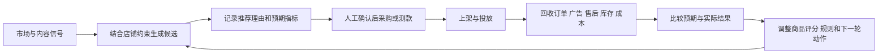

# 跨境选品 AI Agent 市场调研

调研截至 **2026 年 9 月 16 日**。以中国跨境卖家视角，覆盖 Amazon、TikTok Shop、独立站/Dropshipping、采购和 ERP。本文是公开资料调研，核验官网、帮助文档、API 文档及官方开源仓库；没有登录付费产品或验证真实经营收益。产品能力是官方披露，闭环程度与竞争判断是基于这些证据的分析。未找到公开证据，不等于厂商内部没有实现。

## 核心判断

**这个市场已经从“AI 写报告”走到“查数据、串工具、执行部分业务”，但成熟度明显不均。研究自动化、刊登/履约自动化、经营数据回流分别已有商用产品；把三者连接起来，持续用真实销售结果改进下一轮选品，公开证据仍不足。**

三个值得关注的变化：

- 数据厂商正在把能力开放给外部 Agent。卖家精灵、Jungle Scout、FastMoss、SmartScout、Keepa 均有 API/MCP 路线，研究入口不必再固定在各自网页中。[卖家精灵开放平台](https://open.sellersprite.com/)、[Jungle Scout MCP](https://www.junglescout.com/campaign/jungle-scout-mcp/)、[FastMoss CLI](https://github.com/FastMoss/cli)、[SmartScout MCP](https://www.smartscout.com/blog/introducing-our-mcp-server-for-the-api)、[Keepa API](https://keepa.com/api-docs/)。
- 一些产品已经推进到实际执行。Linkfox 有从选品到 Amazon 刊登的工作台；Accio Sourcing Toolkit 连接采购及供应商沟通；Sell The Trend、AutoDS 覆盖商品导入及部分履约。[Linkfox](https://wiki.linkfox.com/solutions/smart-product-test)、[Accio](https://www.accio.com/work/doc?slug=help-accio-sourcing-toolkit)、[Sell The Trend](https://www.sellthetrend.com/dropshipping-platform)、[AutoDS](https://help.autods.com/en/articles/12700438-product-uploads-supported-suppliers-import-to-store-and-manage-variants)。
- 经营数据进入 AI 已经发生。Helium Agent 可分析账户广告和利润；Amazon、Shopify 的原生助手及积加、赛狐的 ERP AI 有真实业务上下文。数据读回来后是否改变“下次选什么”，需要单独核验。[Helium Agent](https://kb.helium10.com/hc/en-us/articles/53970835595931-Helium-Agent)、[Amazon](https://sellingpartners.aboutamazon.com/seller-assistant)、[Shopify](https://help.shopify.com/en/manual/ai-powered-tools/sidekick)、[积加](https://help.jijiaerp.com/docs/rk4iD1LM)、[赛狐](https://www.sellfox.com/function/ai)。

## 玩家版图

这里将直接选品产品与上下游相邻玩家分开标注，不把所有 AI 文案、广告或经营分析产品都当作完整选品 Agent。表中“未证实”专指经营结果自动反馈下一轮选品，不能理解成“没有数据”或“完全不能执行”。

| 玩家 | 主要场景与产品形态 | 数据与工作流 | 已披露边界与闭环判断 |
| --- | --- | --- | --- |
| **LinkfoxAI** | Amazon 为主的选品 Agent / 智选测款工作台 | 多源筛品、需求与利润验证、人工决策、生成并刊登 Listing；另有授权店铺经营数据模块 | 研究→上架及经营数据回流两段均有文档；两段自动反馈选品的机制未证实。[选品工作台](https://wiki.linkfox.com/solutions/smart-product-test)、[经营助手](https://wiki.linkfox.com/features/store-operations) |
| **Accio / Accio Work** | 采购与电商工作台 | Jungle Scout、Alibaba.com 等数据；机会分析→货源比较→询价/议价及下单；可连接 Shopify | 采购动作明确，供应商回复可推进当前采购任务；销售利润驱动后续选品排序未证实。[采购工具包](https://www.accio.com/work/doc?slug=help-accio-sourcing-toolkit)、[功能页](https://www.accio.com/work/feature) |
| **Helium 10 Helium Agent** | Amazon 研究、广告、经营多助手 | 市场/关键词数据与授权账户广告、P&L；自然语言诊断与建议 | 2026-08 帮助文档列明 Diamond+；广告分析只读，另列 Listing 发布工作流。不能泛化为自主投放；选品反馈未证实。[帮助文档](https://kb.helium10.com/hc/en-us/articles/53970835595931-Helium-Agent) |
| **Jungle Scout AI / Cobalt MCP** | Amazon 品牌与企业市场研究 | 竞品销售估算、品类/关键词/价格；按订阅可接自有销售广告；问答→诊断→报告与产品建议 | Cobalt/MCP 企业入口与普通卖家工具要区分；接入、输出文档不等于自动运营。[MCP](https://www.junglescout.com/campaign/jungle-scout-mcp/)、[数据口径](https://support.junglescout.com/hc/en-us/articles/37123724151319-Choosing-the-Right-Jungle-Scout-Platform-Catalyst-Cobalt-MCP) |
| **卖家精灵 SellerSprite** | Amazon 数据 + 内置 Agent / MCP | 商品、关键词、销量、价格、评分和评论；筛品→竞品/市场分析→图表报告 | 公开开放平台以市场数据分析为主；自有订单、利润及选品反馈未证实。[开放平台](https://open.sellersprite.com/) |
| **Sorftime** | 多平台电商数据 MCP | 商品、市场、关键词、评论工具组合；含 Amazon、TikTok、其他平台及 1688 数据服务 | 研究链条较广，具体覆盖按产品文档；平台经营写入与选品反馈未证实。页面访问不稳定，部分据官方搜索索引核验。[MCP](https://www.sorftime.com/en-US/mcp) |
| **FastMoss** | TikTok Shop 数据 + MCP / CLI / Skills | 商品、店铺、达人、视频、直播、广告；发现候选→增长阶段判断→内容/达人验证 | 有可读的工具和业务规则，公开目录以查询分析为主；自有经营结果反馈选品未证实。[CLI](https://github.com/FastMoss/cli)、[选品规则](https://github.com/FastMoss/fastmoss-skills/blob/main/references/fm-product-scout.md) |
| **Kalodata / Kalopilot** | TikTok Shop 数据与 AI 市场洞察 | 公开渠道数据经模型加工；结合商品、达人、视频/直播筛选；相邻 Kalo 产品做达人合作和内容 | 官方承认交易额、广告花费可能偏离真实值；每天训练数据模型不能证明使用本店利润优化选品。[官网 FAQ](https://www.kalodata.com/)、[生态说明](https://www.kalodata.com/blog/tiktok/from-data-to-sales-dominance-how-the-kalo-ecosystem-is-redefining-growth-on-tiktok-shop/) |
| **Minea** | 独立站广告与产品发现 | Meta/TikTok/Pinterest 广告和店铺信号→产品判断→找货源→Shopify 导入 | “Minea Agent”另有 sourcing 服务，不应直接认定为全自动 AI 履约；选品反馈未证实。[AI 研究](https://www.minea.com/ai-product-research)、[导入说明](https://en.minea.com/produits/add-products-shopify-store)、[服务页](https://www.minea.com/es/minea-agent) |
| **Sell The Trend** | Dropshipping 一体化工具 | 趋势研究→供应商→店铺导入→库存同步→订单路由→物流回传 | 操作链较完整；订单/物流同步不等于利润、退款自动进入下一轮推荐。[平台说明](https://www.sellthetrend.com/dropshipping-platform) |
| **AutoDS** | 选品辅助 + 多渠道运营自动化 | Finder/商品库→匹配供应商→导入→价格库存监控→适用供应商的订单处理 | 自动化随渠道和供应商变化，“可导入”不能推导“可自动履约”；推荐反馈未证实。[帮助中心](https://help.autods.com/en/articles/12700438-product-uploads-supported-suppliers-import-to-store-and-manage-variants) |
| **Amazon Seller Assistant + POE** | 平台原生经营助手 + 机会发现 | 平台搜索、点击、购买、评论及卖家上下文→需求缺口→经营建议/部分动作 | 拥有一手行为与经营数据；部分功能逐步推出，不能把路线图都算上线。新品推荐反馈机制未完整公开。[产品页](https://sellingpartners.aboutamazon.com/seller-assistant) |
| **Shopify Sidekick / Pulse** | 平台原生经营助手，相邻竞品 | 真实店铺数据→主动建议→待办→批准执行；可采纳拒绝理由改进后续建议 | 经营与偏好反馈证据明确；Pulse 仍标 early access；跨站找新品不是其主要定位。[Pulse](https://help.shopify.com/en/manual/ai-powered-tools/sidekick/pulse) |
| **积加 AI / 赛狐 AI** | ERP 内嵌 AI，相邻竞品/合作方 | 积加有 ERP 授权、数字员工、定时任务与 MCP；赛狐有商品、广告、VOC、财务分析 | 私有经营数据优势明显；不能把 ERP 所有功能当作 Agent 已能自主执行，自动新品选品反馈未证实。[积加](https://help.jijiaerp.com/docs/rk4iD1LM)、[赛狐](https://www.sellfox.com/function/ai) |

补充观察：SmartScout MCP 偏 Amazon 只读情报；Data Dive 的 AI Product Brief 偏评论驱动的产品差异化研究；Pipiads/EchoTik 偏广告、内容和商品情报。它们分别占据研究链的一段，不应因带 AI 就视为端到端 Agent。[SmartScout](https://www.smartscout.com/blog/introducing-our-mcp-server-for-the-api)、[Data Dive](https://datadive.tools/ai-product-brief-amazon-research-tool/)、[Pipiads](https://www.pipiads.com/)、[EchoTik](https://help.echotik.live/en/collections/3647960-getting-started-with-echotik)。

SellerApp 也有 ML/AI 驱动的商品机会评分，属于算法辅助选品。判断 Agent 成熟度时，应进一步看能否拆任务、调用工具、执行并观察结果，不能仅按是否使用 AI 命名来分类。[SellerApp Product Ideas](https://www.sellerapp.com/amazon-product-ideas.html)。

## 实际工作流怎么做

### 1. Amazon：需求与竞争驱动的研究漏斗

输入目标站点、品类/关键词、售价、资金与履约约束 → 拉候选商品 → 排除过强竞争或明显不适合的候选 → 用搜索、销量历史、季节性与评论交叉验证 → 匹配货源并测成本 → 决策 → 生成与发布 Listing。

Linkfox 是本次样本中流程披露较具体的实例，其九步方案能对应上述链条。但“智选测款”文档的终点是刊登，不能仅凭名称认为它已完成广告测款、回收真实销量并更新下一轮模型。其店铺经营模块确实能同步销售、广告、库存及售后，仍需验证两条链是否自动相连。[新品开发场景](https://wiki.linkfox.com/scenarios/new-product-testing)、[经营助手](https://wiki.linkfox.com/features/store-operations)。

Helium 10、Jungle Scout、卖家精灵等还提供另一入口：围绕 ASIN、关键词或业务问题不断追问，Agent 自动查询与组织数据，再由运营人员推进下一步。MCP 的价值主要在于让 AI 直接调用这些数据工具。[Helium 产品页](https://www.helium10.com/tools/helium-agent/)、[Jungle Scout AI](https://www.junglescout.com/ai-use-cases/)。

### 2. TikTok Shop：产品、内容、达人一起判断

选国家/类目/时间窗口 → 看新上架与增长商品 → 拆商品由哪些达人、视频、直播带动 → 判断热度延续和竞争 → 选内容方向与合作达人 → 人工推进采购、内容与销售测试。

FastMoss 的公开 Skill 明确把达人及视频数量增长作为判断阶段的重要信号，结合 GMV，而不是只按累计销量找商品。这是厂商采用的业务规则，不是已验证的预测准确率。Kalodata 则将分析、达人合作与内容制作分布在多个产品中。[FastMoss 规则](https://github.com/FastMoss/fastmoss-skills/blob/main/references/fm-product-scout.md)、[Kalo 生态](https://www.kalodata.com/blog/tiktok/from-data-to-sales-dominance-how-the-kalo-ecosystem-is-redefining-growth-on-tiktok-shop/)。

### 3. 独立站：广告发现到快速导入与履约

找持续投放/互动增长的广告 → 识别产品与卖点 → 看竞争店铺 → 匹配供应商 → 导入店铺与生成素材 → 测试 → 接收订单与处理履约。Minea 更偏前端发现；Sell The Trend、AutoDS 更深入导入和订单管理。广告持续运行本身不能证明净利润为正，后端订单同步也不能单独证明选品算法在学习。[Minea](https://www.minea.com/winning-product)、[Sell The Trend](https://www.sellthetrend.com/dropshipping-platform)、[AutoDS](https://help.autods.com/en/articles/12700438-product-uploads-supported-suppliers-import-to-store-and-manage-variants)。

### 4. 采购：把机会变成可以买到的商品

Accio 从要求、图片或视频链接出发，做供应商匹配、规格/MOQ/交期/报价比较，再推进沟通与议价。这里供应商回复会改变当前任务的后续动作，属于采购任务内反馈；它与“消费者销售结果改变下一次选品”是不同层次。[Sourcing Toolkit](https://www.accio.com/work/doc?slug=help-accio-sourcing-toolkit)。

## 数据源到底有哪些

| 数据类别 | 典型来源 | 选品用途 | 关键口径 |
| --- | --- | --- | --- |
| 市场商品与历史表现 | SellerSprite、Jungle Scout、Sorftime、Keepa；Amazon 商品/榜单 | 需求规模、竞争强度、价格带、季节性 | 第三方竞品销售常为估算；BSR/价格历史不是实际订单流水。[JS 数据说明](https://support.junglescout.com/hc/en-us/articles/37123724151319-Choosing-the-Right-Jungle-Scout-Platform-Catalyst-Cobalt-MCP)、[Keepa](https://keepa.com/api-docs/) |
| 搜索与购买漏斗 | Amazon ABA/SQP、Product Opportunity Explorer；Google Trends | 搜索需求、点击/购买表现、未满足需求 | SQP 有角色/品牌等限制；Google Trends 是归一化相对指数。[Amazon 报告](https://developer-docs.amazon/sp-api/docs/report-type-values-analytics)、[Google 说明](https://support.google.com/trends/answer/4365533?hl=en) |
| 短视频、达人、直播、广告 | FastMoss、Kalodata、Minea、Pipiads；TikTok Creative Center | 内容可传播性、达人供给、广告创意与产品增长信号 | 广告、互动、GMV、真实利润是不同指标；Kalodata 官方明确其公开渠道数据有偏差。[Kalodata](https://www.kalodata.com/)、[Creative Center](https://ads.tiktok.com/help/article/creative-center?redirected=2) |
| 用户反馈 | Amazon/电商评论、VOC、售后、Customer Feedback API | 找痛点、设计改良与退货原因 | Amazon 此 API 的评论洞察可到 ASIN/类目，退货洞察只到类目；不能宣传为任意竞品的精确退货率。[API 说明](https://developer-docs.amazon/sp-api/docs/customer-feedback-api) |
| 供给与成本 | Alibaba.com、1688、供应商报价与物流参数 | MOQ、交期、采购价、毛利敏感性 | 商品匹配不保证规格一致；预测费用需与实际成本区分。[Accio 工具包](https://www.accio.com/work/doc?slug=help-accio-sourcing-toolkit)、[Linkfox 新品流程](https://wiki.linkfox.com/scenarios/new-product-testing) |
| 自有经营实绩 | 经授权的 Seller Central/SP-API、Amazon Ads、Shopify、TikTok Shop、ERP | 订单、转化、广告成本、售后、库存和利润 | 需要商家授权及权限；接了自有店铺不等于拥有竞争店铺后台。[Shopify 权限](https://shopify.dev/docs/api/usage/access-scopes)、[TikTok 授权](https://partner.tiktokshop.com/docv2/page/seller-authorization-guide)、[Linkfox 经营模块](https://wiki.linkfox.com/features/store-operations) |

**最容易误判的一点：API/MCP 是访问方式，不是数据真实性等级。** MCP 返回的数据可以是官方交易、公开页面、供应商估算，也可以是混合指标。必须继续追问字段从哪里来、多久刷新、是观测还是推算。

目前可明确核实的来源组合包括 Accio 的 Jungle Scout + Alibaba.com，以及 Linkfox 披露的 SellerSprite/SIF/Keepa/Google Trends/1688 等。其他厂商若仅写“大数据 + AI”，不能替它补出未公开的数据供应商或授权关系。

## 有没有形成数据闭环

判断闭环不用要求重新训练基础大模型。只要实际结果能改变规则、评分、店铺记忆或下一轮动作，就可以形成相应层次的闭环。

| 层次 | 判定问题 | 本次结论 |
| --- | --- | --- |
| 外部数据更新 | 竞品、趋势、评论会不会继续更新？ | 已普遍存在，但仅能证明持续观察市场 |
| 执行及经营反馈 | 上架/订单执行后，销售、库存、广告、售后等能否返回系统用于复盘？ | 多个样本具备全部或部分环节；Linkfox、平台助手、ERP、自有数据型套件与履约工具各有所长 |
| 选品决策反馈 | 能否把某次推荐与后续经营结果关联，自动改进下一轮推荐？ | 有个性化与偏好反馈的局部证据，但未找到足以验证“跨境新品完整自动闭环”的公开资料 |

两个正面例子也需要准确限定：

- Shopify Pulse 会利用“为什么拒绝这条建议”的反馈，个性化后续建议。这能证明偏好反馈，不能替代利润驱动的新品学习证据。[Pulse 文档](https://help.shopify.com/en/manual/ai-powered-tools/sidekick/pulse)。
- Amazon B2B 机会报告的参数说明默认推荐考虑卖家历史，属于个性化推荐的证据；这是特定 B2B 接口，不能外推成 Seller Assistant 全部选品行为。[B2B 机会报告](https://developer-docs.amazon/sp-api/docs/report-type-values-b2b-product-opportunities)。

下图是用于判断完整闭环的概念模型，不代表任一厂商都已实现：

真正需要验证的是最后两个箭头。看板能展示结果，只证明数据回来了；同一个工作台同时有选品和财务模块，只证明能力共存。需要找到推荐记录与结果之间的关联以及决策更新记录。

本次公开资料中尚不清楚的事项：是否保存当时没有被选中的候选、失败测款是否进入训练/规则数据、是否校正断货与流量不足、是否区分商品问题和素材/定价问题、是否记录评分版本，以及更新后是否确实提高新品表现。未披露这些，并不等于其经营工具没有价值；只是不能据此认可“越用越会选”的强主张。

## 对产品机会的判断

以下属于研究者推断，不是市场规模预测或厂商承诺。

**仅做“多数据源 + 聊天 + 选品报告”更容易同质化。** 数据商开放 MCP 后，通用 Agent 可以越来越容易地组合查询。产品仍可通过可靠性、行业流程和用户体验创造价值，但单靠接入大模型很难形成独占优势。

更有区分度的切入点是：**针对某类卖家，把候选、测试、结果和下一轮动作连成可追溯记录。** 同一个商品是否值得做，取决于该卖家的供应链、资金、内容能力、库存和历史表现，而不只取决于全市场榜单。

如果做产品，建议优先验证一个平台、一个品类的循环：

1. 保存候选来源、推荐理由、预测销量/利润区间和不确定性，同时保存被否决原因。
2. 为获批候选建立测试计划与 SKU/Listing/广告/供应商关联，让后续结果能找回最初假设。
3. 取回真实销售、广告、退款、履约及成本数据，观察单位贡献利润、周转和退货，而不只优化 GMV。
4. 区分产品、定价、素材、流量、库存及供应商问题，提出继续测试、放量、修改或停止的动作。
5. 记录下轮评分/规则如何变化，并通过对照或时间外样本判断是否改善，而不是只展示个别成功案例。

这里的单位贡献利润应使用一致口径：净成交收入扣除采购、平台、履约、广告及相应售后损耗；如未计管理和其他固定开支，不称净利润。这个指标设计是建议，并非上述各家已采用的统一标准。

竞争关注对象也随切入点不同：做研究体验，重点看 SellerSprite/Jungle Scout/FastMoss 等数据商；做流程，重点看 Linkfox/Accio；做经营反馈，重点看 ERP 与 Amazon/Shopify 原生助手。后两类掌握执行入口或私有实绩，更值得持续跟踪。

## 核验边界与配套证据

没有用数据库条数、用户量、营销 ROI 或“AI 爆款预测”口号评定产品效果。未做市场份额排名；未以局部页面的公开缺失证明某项功能绝对不存在。套餐、站点、第三方授权和灰度发布会影响可用性。

针对容易混淆的结论已做补充核查：Helium 的只读分析与 Listing 工作流分开描述；Linkfox 补查了九步刊登与真实店铺数据模块；AutoDS 文档中的 FBA 是 Fulfilled by AutoDS，在其语境中不是 Amazon FBA。

配套证据备忘录：

- [Amazon 第三方产品证据](/Users/lihaixin03/workspace/tool/product-res/research/amazon-vendors-evidence.md)
- [中国本土产品证据](/Users/lihaixin03/workspace/tool/product-res/research/china-vendors-evidence.md)
- [TikTok 与独立站产品证据](/Users/lihaixin03/workspace/tool/product-res/research/tiktok-dtc-evidence.md)
- [平台原生产品与数据接口证据](/Users/lihaixin03/workspace/tool/product-res/research/platform-data-evidence.md)
